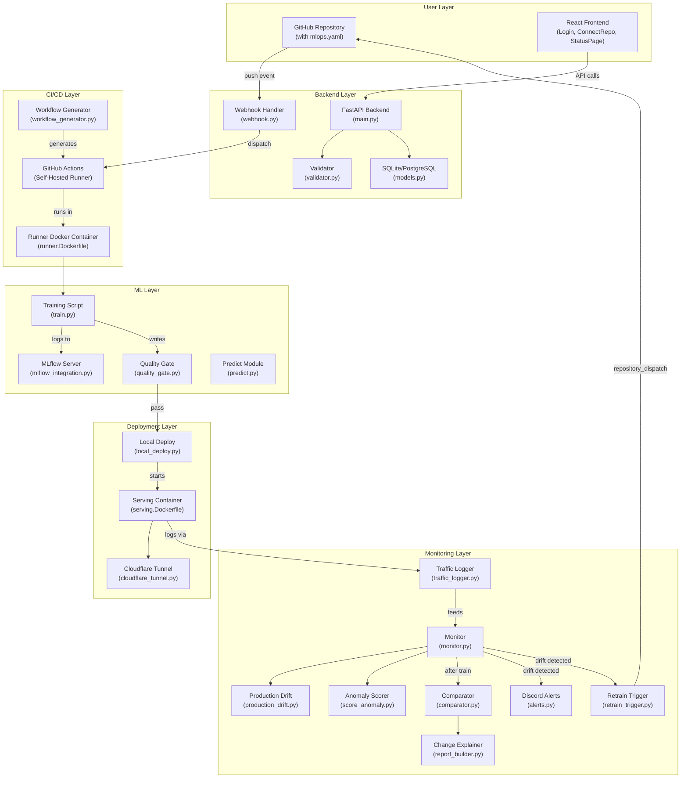
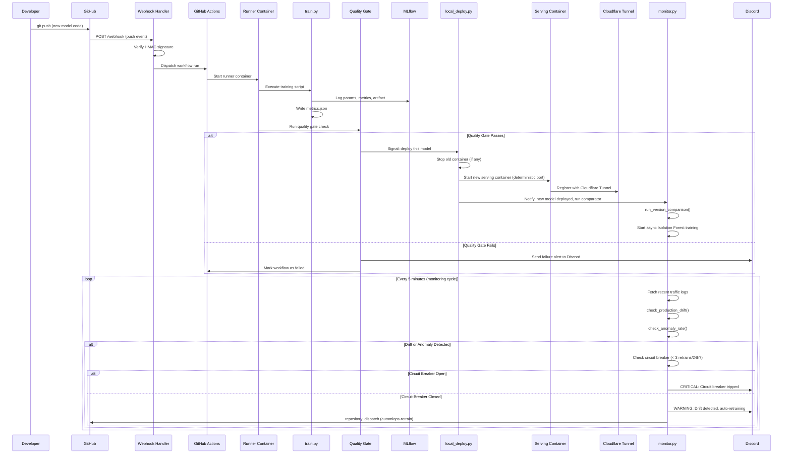
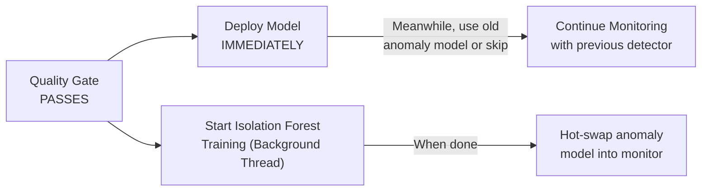
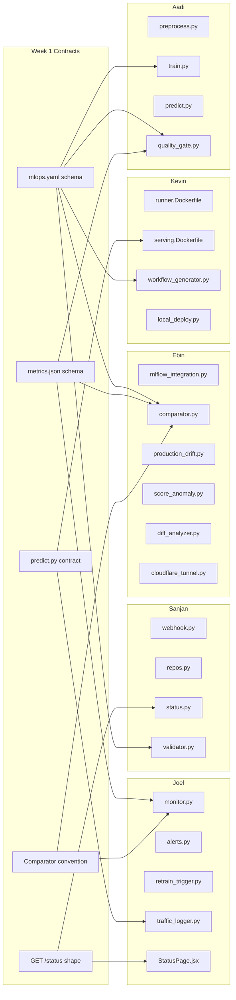

# AutoMLOps — Comprehensive Implementation Plan

> [!IMPORTANT]
> This document is the single source of truth for the AutoMLOps platform build. Every team member should read this end-to-end before writing code. All shared contracts (Section 2) **must** be locked in during Week 1 — nothing downstream can be finalized without them.

---

## Table of Contents

1. [Project Overview & Goals](#1-project-overview--goals)
2. [Shared Contracts & Schemas (Week 1 Lock-In)](#2-shared-contracts--schemas-week-1-lock-in)
3. [Architecture Overview](#3-architecture-overview)
4. [Critical Vulnerability Fixes (Built-In from Day 1)](#4-critical-vulnerability-fixes-built-in-from-day-1)
5. [Repository Structure](#5-repository-structure)
6. [File-Level Specification by Owner](#6-file-level-specification-by-owner)
7. [Cross-Cutting Integration Points](#7-cross-cutting-integration-points)
8. [Phased Execution Timeline](#8-phased-execution-timeline)
9. [Testing & Validation Strategy](#9-testing--validation-strategy)
10. [Risk Register & Mitigations](#10-risk-register--mitigations)

---

## 1. Project Overview & Goals

### What is AutoMLOps?

AutoMLOps is a self-hosted MLOps platform that automatically manages the lifecycle of machine learning models connected via GitHub repositories. When a user connects a repo, the platform:

1. **Validates** the repo structure against a declared `mlops.yaml` manifest
2. **Runs CI/CD** training pipelines on a self-hosted GPU runner (RTX 3050)
3. **Gates deployments** on quality thresholds (accuracy, precision, etc.)
4. **Deploys** passing models as live prediction APIs via Docker containers
5. **Monitors** production traffic for data drift and anomalies (Evidently AI + Isolation Forest)
6. **Explains** what changed between model versions (AST-based code diff + metric deltas)
7. **Auto-retrains** when drift is detected (with circuit-breaker protection)
8. **Exposes** everything via a React dashboard with GitHub OAuth

### Team

| Member   | Domain                                                      |
|----------|-------------------------------------------------------------|
| Kevin    | DevOps Core — Runner, Docker, CI/CD, Deployment             |
| Sanjan   | FastAPI Backend — API, Webhooks, Validation, Database        |
| Aadi     | ML Work — Preprocessing, Training, Inference, Quality Gate  |
| Ebin     | ML Support — MLflow, Evidently, Isolation Forest, Tunnels   |
| Joel     | Monitoring, Alerts, Retraining, Frontend                    |

---

## 2. Shared Contracts & Schemas (Week 1 Lock-In)

> [!CAUTION]
> These contracts are the foundation of the entire platform. Any change to them after Week 1 cascades into every team member's code. Finalize them **before** writing implementation code.

### 2.1 `mlops.yaml` Schema

Every connected repository must include this file at its root.

```yaml
# mlops.yaml — Canonical Schema (v1)
project_name: "my-ml-project"            # Human-readable name
framework: "sklearn"                       # One of: sklearn | pytorch | tensorflow
task_type: "classification"                # One of: classification | regression  ← NEW (vulnerability fix)
entry_point: "ml/train.py"                 # Relative path to training script
predict_module: "ml/predict.py"            # Relative path to predict.py
target_column: "label"                     # Name of the target column in the dataset
numerical_features:                        # List of numerical feature column names
  - "feature_1"
  - "feature_2"
categorical_features:                      # List of categorical feature column names
  - "category_a"
  - "category_b"
metrics_threshold:                         # Quality gate thresholds (AND logic)
  accuracy: 0.85                           # Classification metrics
  precision: 0.80
  # For regression repos, use: rmse, mae, r_squared instead
dependencies: "requirements.txt"           # Relative path to pip requirements file
dataset_path: "data/dataset.csv"           # Relative path to training dataset
```

**Validation rules** (enforced by `validator.py`):
- `framework` must be one of the three allowed values
- `task_type` must be `classification` or `regression`
- `entry_point` and `predict_module` must point to files that actually exist in the repo
- `target_column` must be a non-empty string
- At least one of `numerical_features` or `categorical_features` must be non-empty
- `metrics_threshold` keys must match the declared `task_type`:
  - Classification → allowed keys: `accuracy`, `precision`, `recall`, `f1`
  - Regression → allowed keys: `rmse`, `mae`, `r_squared`
- `dependencies` must point to an existing file

### 2.2 `metrics.json` Output Schema

Every training script must write this file at the end of training.

**Classification output:**
```json
{
  "task_type": "classification",
  "accuracy": 0.92,
  "precision": 0.89,
  "recall": 0.91,
  "f1": 0.90,
  "loss": 0.23,
  "training_time_sec": 145.7,
  "timestamp": "2026-10-19T12:00:00Z",
  "commit_sha": "abc123def456",
  "model_artifact_path": "artifacts/model.pkl"
}
```

**Regression output:**
```json
{
  "task_type": "regression",
  "rmse": 2.34,
  "mae": 1.87,
  "r_squared": 0.94,
  "loss": 0.15,
  "training_time_sec": 203.1,
  "timestamp": "2026-10-19T12:00:00Z",
  "commit_sha": "abc123def456",
  "model_artifact_path": "artifacts/model.pkl"
}
```

**Consumers of `metrics.json`:**
| File                          | Owner  | How it uses `metrics.json`                              |
|-------------------------------|--------|---------------------------------------------------------|
| `quality_gate.py`             | Aadi   | Compares values against `metrics_threshold` from YAML   |
| `monitor.py`                  | Joel   | Reads after training run completes, triggers comparator |
| `comparator.py`               | Ebin   | Pulls metric deltas between v1 and v2                   |
| `report_builder.py`           | Ebin   | Includes metric changes in the human-readable report    |
| `status.py`                   | Sanjan | Serves latest metrics via the status endpoint           |

### 2.3 `GET /status/{repo_id}` Response Shape

```json
{
  "repo_id": "repo_abc123",
  "repo_name": "my-ml-project",
  "github_url": "https://github.com/user/my-ml-project",
  "latest_run": {
    "run_id": "run_xyz789",
    "commit_sha": "abc123def456",
    "status": "passed",
    "triggered_by": "push",
    "started_at": "2026-10-19T11:30:00Z",
    "completed_at": "2026-10-19T11:35:00Z",
    "metrics": {
      "task_type": "classification",
      "accuracy": 0.92,
      "precision": 0.89,
      "recall": 0.91,
      "f1": 0.90
    },
    "quality_gate": "passed"
  },
  "deployment": {
    "status": "active",
    "url": "https://my-ml-project.automlops.tunnel.example.com",
    "port": 8001,
    "deployed_commit_sha": "abc123def456",
    "deployed_at": "2026-10-19T11:36:00Z"
  },
  "monitoring": {
    "drift_detected": false,
    "drifted_columns": [],
    "anomaly_rate": 0.03,
    "anomaly_threshold": 0.15,
    "last_checked_at": "2026-10-19T11:50:00Z",
    "retrain_count_24h": 0,
    "circuit_breaker_active": false
  },
  "reports": {
    "version_comparison_html": "/reports/repo_abc123/comparison_latest.html",
    "production_drift_html": "/reports/repo_abc123/drift_latest.html",
    "change_explainer": {
      "summary": "learning_rate changed from 0.01 to 0.001; accuracy improved by +3.2%",
      "details": [
        "Hyperparameter change: learning_rate 0.01 → 0.001",
        "Metric delta: accuracy +0.032 (0.888 → 0.920)",
        "No data drift detected between training versions"
      ]
    }
  }
}
```

### 2.4 `predict.py` Input/Output Contract

```python
# Every connected repo's predict.py MUST expose this exact signature:

def predict(input_dict: dict) -> dict:
    """
    Args:
        input_dict: A dictionary mapping feature names to values.
            Example: {"feature_1": 5.2, "feature_2": 3.1, "category_a": "X"}
    
    Returns:
        A dictionary with at minimum:
            - "prediction": the model's output (class label or numeric value)
            - "confidence": float between 0-1 (probability for classification, 
                           or None for regression)
    
    Example return (classification):
        {"prediction": "positive", "confidence": 0.93}
    
    Example return (regression):
        {"prediction": 42.7, "confidence": null}
    """
```

### 2.5 Comparator Call Convention

> **Decision: Direct Python import** (not internal API)

```python
# In monitor.py (Joel's code), after a training run completes:
from comparator.comparator import run_version_comparison

report_dict, html_path = run_version_comparison(
    repo_id="repo_abc123",
    current_metrics_path="path/to/current/metrics.json",
    previous_run_id="mlflow_run_id_of_last_deployed"
)
```

This avoids the overhead of an HTTP round-trip for an in-process call, and keeps the comparator testable as a pure function.

### 2.6 Retrain Circuit Breaker Parameters

| Parameter                     | Value | Rationale                                          |
|-------------------------------|-------|----------------------------------------------------|
| Max auto-retrains per 24h     | 3     | Prevents infinite loop while allowing recovery     |
| Cooldown after circuit trips  | 6h    | Minimum gap before another auto-retrain attempt    |
| Manual override endpoint      | `POST /repos/{repo_id}/retrain` | Human can force-retrain bypassing circuit breaker |
| Discord alert on trip         | Yes   | Critical severity, tags @everyone                  |

### 2.7 Deterministic Port Assignment

```
Port = 8000 + repo.sequential_id
```

| Repo Sequential ID | Assigned Port | Purpose         |
|---------------------|---------------|-----------------|
| 0                   | 8000          | FastAPI Backend |
| 1                   | 8001          | Repo #1 serving |
| 2                   | 8002          | Repo #2 serving |
| N                   | 8000 + N      | Repo #N serving |

This eliminates port exhaustion and state-loss issues. The port is a deterministic function of the repo ID, so even if the backend crashes and restarts, it can reconstruct which port belongs to which repo without any external state.

---

## 3. Architecture Overview



### Data Flow — End-to-End Pipeline



---

## 4. Critical Vulnerability Fixes (Built-In from Day 1)

> [!WARNING]
> These are not "nice-to-haves." Each vulnerability **will** break the platform during a live demo if left unaddressed. They are integrated into the file specs below, not treated as separate tasks.

### 4.1 The Infinite Retraining Loop → Circuit Breaker

**Problem:** Drift detected → retrain → new model still drifts → retrain → infinite loop burning GPU compute.

**Solution — implemented in `retrain_trigger.py`:**

```python
# Pseudocode for circuit breaker logic
def should_retrain(repo_id: str) -> bool:
    recent_retrains = db.query(
        "SELECT COUNT(*) FROM retrains "
        "WHERE repo_id = ? AND triggered_at > datetime('now', '-24 hours')",
        repo_id
    )
    if recent_retrains >= MAX_AUTO_RETRAINS_PER_24H:  # = 3
        send_alert(
            f"🚨 CIRCUIT BREAKER TRIPPED for {repo_id}. "
            f"{recent_retrains} auto-retrains in 24h. Human intervention required.",
            severity="critical"
        )
        return False
    return True
```

**Database table addition** (in `models.py`):
```python
class Retrain(Base):
    __tablename__ = "retrains"
    id = Column(Integer, primary_key=True)
    repo_id = Column(String, ForeignKey("repos.id"))
    triggered_at = Column(DateTime, default=datetime.utcnow)
    trigger_reason = Column(String)  # "drift", "anomaly", "manual"
    status = Column(String)  # "pending", "completed", "failed"
```

### 4.2 Classification Bias → Task-Type-Aware Metrics

**Problem:** `metrics.json` hardcodes classification keys. Regression models crash the pipeline.

**Solution — implemented across multiple files:**

| File               | Change                                                                           |
|--------------------|----------------------------------------------------------------------------------|
| `mlops.yaml`       | Add `task_type: classification | regression`                                     |
| `train.py`         | Write `task_type` key into `metrics.json`                                        |
| `quality_gate.py`  | Read `task_type` from YAML, validate against correct metric keys                 |
| `comparator.py`    | Use `ClassificationPreset()` or `RegressionPreset()` based on `task_type`        |
| `validator.py`     | Validate that `metrics_threshold` keys match the declared `task_type`             |

### 4.3 Anomaly Model Race Condition → Async Training

**Problem:** Waiting for Isolation Forest to finish before deploying adds latency to the CI/CD pipeline.

**Solution — implemented in `monitor.py` + `local_deploy.py`:**



The main model deploys the moment the quality gate passes. The Isolation Forest trains in a background thread/process. Until it finishes, the monitor either uses the previous version's anomaly model or skips anomaly checking (drift detection alone is still active).

### 4.4 Port Exhaustion & State Loss → Deterministic Ports

**Problem:** Random free ports are lost on backend crash, leaving orphaned containers.

**Solution — implemented in `local_deploy.py`:**

```python
def get_repo_port(repo_sequential_id: int) -> int:
    """Deterministic port assignment. No state to lose."""
    BASE_PORT = 8001  # 8000 is reserved for the backend itself
    return BASE_PORT + repo_sequential_id

# On startup recovery:
def recover_deployments():
    """Re-discover running containers even after a backend crash."""
    for repo in db.query(Repo).filter(Repo.is_deployed == True):
        expected_port = get_repo_port(repo.sequential_id)
        container_name = f"automlops-serve-{repo.id}"
        if not docker_container_running(container_name):
            log.warning(f"Orphaned deployment for {repo.id}, cleaning up")
            docker_stop_and_remove(container_name)
            repo.is_deployed = False
```

---

## 5. Repository Structure

```
MLops/
├── README.md
├── docker-compose.yml                    # Kevin — orchestrates all services
│
├── runner/
│   └── setup_runner.sh                   # Kevin — self-hosted runner registration
│
├── github_app/
│   └── app_config.py                     # Kevin — GitHub App credentials & tokens
│
├── docker/
│   ├── runner.Dockerfile                 # Kevin — training execution environment
│   └── serving.Dockerfile                # Kevin — model serving container
│
├── cicd/
│   └── workflow_generator.py             # Kevin — generates .github/workflows/mlops.yml
│
├── deploy/
│   └── local_deploy.py                   # Kevin — container lifecycle management
│
├── backend/
│   ├── main.py                           # Sanjan — FastAPI app entry point
│   ├── routes/
│   │   ├── webhook.py                    # Sanjan — GitHub push event handler
│   │   ├── repos.py                      # Sanjan — repo CRUD endpoints
│   │   └── status.py                     # Sanjan — status dashboard endpoint
│   ├── services/
│   │   └── validator.py                  # Sanjan — mlops.yaml validation
│   └── db/
│       └── models.py                     # Sanjan — ORM models (SQLAlchemy)
│
├── ml/
│   ├── data/
│   │   └── preprocess.py                 # Aadi — data cleaning & splitting
│   ├── train.py                          # Aadi — v1 training script
│   ├── predict.py                        # Aadi — inference contract
│   ├── quality_gate.py                   # Aadi — pass/fail threshold check
│   ├── train_v2.py                       # Ebin — v2 training variant
│   └── mlflow_integration.py             # Ebin — MLflow client wrapper
│
├── comparator/
│   ├── comparator.py                     # Ebin — Evidently version comparison
│   └── production_drift.py               # Ebin — Evidently live drift detection
│
├── anomaly/
│   ├── train_anomaly_model.py            # Ebin — Isolation Forest training
│   ├── score_anomaly.py                  # Ebin — live anomaly scoring
│   └── evaluate_anomaly_model.py         # Ebin — evaluation harness (report only)
│
├── change_explainer/
│   ├── diff_analyzer.py                  # Ebin — AST-based code diff
│   └── report_builder.py                 # Ebin — combined change report
│
├── tunnel/
│   └── cloudflare_tunnel.py              # Ebin — tunnel management
│
├── monitoring/
│   ├── monitor.py                        # Joel — orchestration scheduler
│   ├── alerts.py                         # Joel — Discord webhook alerts
│   ├── retrain_trigger.py                # Joel — GitHub dispatch + circuit breaker
│   └── traffic_logger.py                 # Joel — request/response logging
│
├── frontend/
│   ├── package.json
│   ├── public/
│   └── src/
│       ├── App.jsx
│       ├── components/
│       │   ├── Login.jsx                 # Joel — GitHub OAuth flow
│       │   ├── ConnectRepo.jsx           # Joel — repo connection form
│       │   └── StatusPage.jsx            # Joel — main dashboard
│       └── ...
│
├── tests/                                # All team members
│   ├── test_validator.py
│   ├── test_quality_gate.py
│   ├── test_comparator.py
│   ├── test_anomaly.py
│   ├── test_monitor.py
│   └── ...
│
└── demo_repo/                            # Aadi — reference connected repo
    ├── mlops.yaml
    ├── requirements.txt
    ├── data/
    │   └── dataset.csv
    └── ml/
        ├── train.py
        └── predict.py
```

---

## 6. File-Level Specification by Owner

### 6.1 Kevin — DevOps Core

---

#### `runner/setup_runner.sh`

| Attribute       | Detail                                                                                         |
|-----------------|------------------------------------------------------------------------------------------------|
| **Purpose**     | Register the self-hosted GitHub Actions runner on the GPU machine                               |
| **Inputs**      | Environment variables: `GITHUB_APP_ID`, `GITHUB_PRIVATE_KEY_PATH`, `RUNNER_TOKEN`, `REPO_URL`  |
| **Outputs**     | A running `actions-runner` service registered with label `self-hosted`                          |
| **Idempotency** | Must detect existing registration and skip; safe to re-run                                     |
| **Dependencies**| `github_app/app_config.py` (for credentials)                                                   |

**Key operations:**
1. Download the latest `actions-runner` binary for Linux x64
2. Configure against the GitHub App's installation credentials
3. Register with the label `self-hosted` so workflow files can target it via `runs-on: self-hosted`
4. Install as a systemd service for auto-restart
5. Verify GPU access (`nvidia-smi`) and log the result

---

#### `github_app/app_config.py`

| Attribute       | Detail                                                                                |
|-----------------|---------------------------------------------------------------------------------------|
| **Purpose**     | Manage GitHub App authentication and token generation                                  |
| **Inputs**      | Env vars: `GITHUB_APP_ID`, `GITHUB_PRIVATE_KEY_PATH`, `GITHUB_WEBHOOK_SECRET`         |
| **Outputs**     | Installation access tokens for API calls                                               |
| **Consumers**   | `webhook.py`, `retrain_trigger.py`, `workflow_generator.py`                            |

**Exposed functions:**
```python
def get_app_config() -> dict:
    """Returns App ID, private key, webhook secret from env vars."""

def generate_installation_token(installation_id: str) -> str:
    """Generates a short-lived installation access token for repo operations."""

def verify_webhook_signature(payload: bytes, signature: str) -> bool:
    """HMAC-SHA256 verification of incoming webhook payloads."""
```

---

#### `docker/runner.Dockerfile`

| Attribute       | Detail                                                                                      |
|-----------------|----------------------------------------------------------------------------------------------|
| **Purpose**     | Docker image for executing training scripts inside CI/CD                                     |
| **Base image**  | `nvidia/cuda:12.1-runtime-ubuntu22.04` (or equivalent with GPU support)                      |
| **Pre-installed**| Python 3.10+, scikit-learn, pytorch, tensorflow, mlflow, pandas, numpy, evidently             |
| **Volumes**     | Mounts cloned repo at `/workspace`, writes to `/output` (metrics.json, model artifacts)      |
| **Entrypoint**  | `python /workspace/{entry_point}` (from mlops.yaml)                                          |

**Build stages:**
1. Base ML environment with common libraries
2. `pip install -r /workspace/requirements.txt` for repo-specific deps
3. Run the training script
4. Copy `metrics.json` and model artifacts to the shared `/output` volume

---

#### `docker/serving.Dockerfile`

| Attribute       | Detail                                                                              |
|-----------------|--------------------------------------------------------------------------------------|
| **Purpose**     | Wrap a trained model's `predict.py` in a FastAPI serving app                         |
| **Inputs**      | Model artifact (mounted or copied), `predict.py` from the repo                       |
| **Endpoints**   | `POST /predict` (calls `predict.py`'s `predict()` function), `GET /health`           |
| **Consumers**   | `local_deploy.py`, `cloudflare_tunnel.py`, `traffic_logger.py`                       |

**The FastAPI wrapper inside the container:**
```python
# Pseudocode for the serving app baked into the Dockerfile
from fastapi import FastAPI
from predict import predict  # imported from the connected repo

app = FastAPI()
model = None  # loaded once at startup, not per-request

@app.on_event("startup")
def load_model():
    global model
    model = load_model_artifact("/model/model.pkl")

@app.post("/predict")
def handle_predict(input_dict: dict):
    result = predict(input_dict)
    # traffic_logger.py hooks in here (middleware)
    return result

@app.get("/health")
def health():
    return {"status": "healthy", "model_loaded": model is not None}
```

---

#### `cicd/workflow_generator.py`

| Attribute       | Detail                                                                              |
|-----------------|--------------------------------------------------------------------------------------|
| **Purpose**     | Generate the `.github/workflows/mlops.yml` for a connected repo                     |
| **Inputs**      | Parsed `mlops.yaml` (framework, entry_point, dependencies path)                      |
| **Outputs**     | A complete workflow YAML file string                                                 |
| **Consumers**   | Called by `repos.py` on `POST /repos/connect`                                        |

**Exposed functions:**
```python
def generate_workflow(mlops_config: dict, backend_url: str) -> str:
    """
    Returns the content of a .github/workflows/mlops.yml file.
    
    The generated workflow:
    1. Triggers on: push to main, repository_dispatch (automlops-retrain)
    2. runs-on: self-hosted
    3. Checks out the repo
    4. Builds and runs the runner Docker container
    5. Runs quality_gate.py
    6. Calls back to the FastAPI backend with results
    """
```

---

#### `deploy/local_deploy.py`

| Attribute       | Detail                                                                              |
|-----------------|--------------------------------------------------------------------------------------|
| **Purpose**     | Manage serving container lifecycle with deterministic port assignment                 |
| **Inputs**      | Repo ID, model artifact path, commit SHA                                             |
| **Outputs**     | Running serving container on deterministic port                                       |
| **Consumers**   | Called by the CI/CD pipeline after quality gate passes                                |

**Exposed functions:**
```python
def get_repo_port(repo_sequential_id: int) -> int:
    """Deterministic port: 8001 + sequential_id."""

def deploy_model(repo_id: str, model_artifact_path: str, commit_sha: str) -> dict:
    """
    1. Stop existing container for this repo (if any)
    2. Build/tag the serving image with the new model
    3. Start the new container on the deterministic port
    4. Update the database (Deployment table) with port + commit SHA
    5. Notify Ebin's cloudflare_tunnel.py to update tunnel target
    6. Return {"port": int, "container_id": str, "status": "deployed"}
    """

def recover_deployments() -> None:
    """
    Called on backend startup. Iterates all repos marked as deployed,
    verifies their containers are running, cleans up orphans.
    """

def stop_deployment(repo_id: str) -> None:
    """Stop and remove the serving container for a repo."""
```

---

#### `docker-compose.yml`

| Service            | Port  | Purpose                                               |
|--------------------|-------|-------------------------------------------------------|
| `backend`          | 8000  | FastAPI backend (Sanjan's code)                       |
| `mlflow`           | 5000  | Self-hosted MLflow tracking server                    |
| `frontend`         | 3000  | React dev server (Joel's code)                        |

> [!NOTE]
> Per-repo serving containers are **not** in docker-compose. They are started dynamically by `local_deploy.py`. Only the infrastructure services are composed.

---

### 6.2 Sanjan — FastAPI Backend

---

#### `backend/main.py`

| Attribute       | Detail                                                                              |
|-----------------|--------------------------------------------------------------------------------------|
| **Purpose**     | FastAPI application entry point and configuration                                    |
| **Outputs**     | Running FastAPI server on port 8000                                                  |

**Responsibilities:**
```python
from fastapi import FastAPI
from fastapi.middleware.cors import CORSMiddleware
from backend.routes import webhook, repos, status
from backend.db.models import init_db

app = FastAPI(title="AutoMLOps", version="1.0.0")

# CORS for React frontend on port 3000
app.add_middleware(CORSMiddleware, allow_origins=["http://localhost:3000"], ...)

# Register routers
app.include_router(webhook.router, prefix="/webhook", tags=["webhook"])
app.include_router(repos.router, prefix="/repos", tags=["repos"])
app.include_router(status.router, prefix="/status", tags=["status"])

@app.on_event("startup")
async def startup():
    init_db()  # Create tables if not exist
    recover_deployments()  # Kevin's function — re-discover running containers
```

---

#### `backend/routes/webhook.py`

| Attribute       | Detail                                                                              |
|-----------------|--------------------------------------------------------------------------------------|
| **Purpose**     | Receive and verify GitHub push event webhooks                                        |
| **Security**    | HMAC-SHA256 signature verification — **reject all unverified payloads**              |
| **Inputs**      | Raw HTTP request body + `X-Hub-Signature-256` header                                 |
| **Outputs**     | Triggers CI/CD workflow dispatch                                                     |

**Exposed endpoint:**
```python
@router.post("/github")
async def handle_github_webhook(request: Request):
    """
    1. Read raw body
    2. Verify HMAC signature via app_config.verify_webhook_signature()
    3. Parse the push event (extract repo URL, commit SHA, branch)
    4. Look up the repo in the database (is it a connected repo?)
    5. If yes, dispatch the CI/CD workflow via GitHub API
    6. Create a new Run record in the database with status="pending"
    """
```

---

#### `backend/routes/repos.py`

| Endpoint                      | Method | Purpose                                      |
|-------------------------------|--------|----------------------------------------------|
| `/repos/connect`              | POST   | Connect a new GitHub repo                     |
| `/repos`                      | GET    | List all connected repos for current user     |
| `/repos/{repo_id}`            | DELETE | Disconnect a repo, stop its serving container |
| `/repos/{repo_id}/retrain`    | POST   | Manual retrain (bypasses circuit breaker)     |

**`POST /repos/connect` flow:**
1. Receive `github_url` from request body
2. Use GitHub API (via installation token) to fetch the repo's file tree
3. Call `validator.py` to check `mlops.yaml` exists and is valid
4. If valid: create `Repo` record, assign `sequential_id`, call `workflow_generator.py` to push the workflow file
5. If invalid: return 422 with the specific validation error

---

#### `backend/routes/status.py`

| Attribute       | Detail                                                                              |
|-----------------|--------------------------------------------------------------------------------------|
| **Purpose**     | Serve the dashboard data endpoint                                                    |
| **Contract**    | Returns the exact JSON shape from Section 2.3                                        |
| **Consumer**    | Joel's `StatusPage.jsx`                                                              |

**Implementation notes:**
- Joins across `Repo`, `Run`, and `Deployment` tables
- Reads the latest monitoring state from the database
- Serves Evidently HTML report file paths (static file serving for the HTML)
- Includes the change-explainer summary from the latest report

---

#### `backend/services/validator.py`

| Attribute       | Detail                                                                              |
|-----------------|--------------------------------------------------------------------------------------|
| **Purpose**     | Validate a connected repo's `mlops.yaml` against the schema                          |
| **Inputs**      | Raw YAML string + list of files in the repo                                          |
| **Outputs**     | `(is_valid: bool, errors: list[str])`                                                |

**Exposed function:**
```python
def validate_repo(yaml_content: str, repo_file_list: list[str]) -> tuple[bool, list[str]]:
    """
    Checks:
    1. mlops.yaml parses as valid YAML
    2. All required fields present: framework, task_type, entry_point, predict_module,
       target_column, metrics_threshold, dependencies
    3. framework in ["sklearn", "pytorch", "tensorflow"]
    4. task_type in ["classification", "regression"]
    5. entry_point file exists in repo_file_list
    6. predict_module file exists in repo_file_list
    7. dependencies file exists in repo_file_list
    8. metrics_threshold keys match task_type:
       - classification: accuracy, precision, recall, f1
       - regression: rmse, mae, r_squared
    9. At least one feature list (numerical or categorical) is non-empty
    
    Returns (True, []) if valid, or (False, ["error1", "error2"]) if invalid.
    Error messages must be specific and actionable:
      BAD:  "Invalid mlops.yaml"
      GOOD: "entry_point 'ml/train.py' not found in repository. Available .py files: [...]"
    """
```

---

#### `backend/db/models.py`

```python
from sqlalchemy import Column, Integer, String, DateTime, Boolean, JSON, ForeignKey
from sqlalchemy.ext.declarative import declarative_base
from datetime import datetime

Base = declarative_base()

class Repo(Base):
    __tablename__ = "repos"
    id = Column(String, primary_key=True)           # UUID
    sequential_id = Column(Integer, unique=True)     # For deterministic port assignment
    github_url = Column(String, nullable=False)
    owner = Column(String, nullable=False)           # GitHub username
    mlops_yaml = Column(JSON)                        # Snapshot of parsed mlops.yaml
    is_deployed = Column(Boolean, default=False)
    created_at = Column(DateTime, default=datetime.utcnow)

class Run(Base):
    __tablename__ = "runs"
    id = Column(String, primary_key=True)            # UUID
    repo_id = Column(String, ForeignKey("repos.id"))
    commit_sha = Column(String, nullable=False)
    status = Column(String, default="pending")       # pending | running | passed | failed
    metrics_json = Column(JSON, nullable=True)
    quality_gate_result = Column(String, nullable=True)  # passed | failed
    triggered_by = Column(String, default="push")    # push | automlops-retrain | manual
    started_at = Column(DateTime, default=datetime.utcnow)
    completed_at = Column(DateTime, nullable=True)

class Deployment(Base):
    __tablename__ = "deployments"
    id = Column(String, primary_key=True)
    repo_id = Column(String, ForeignKey("repos.id"))
    port = Column(Integer, nullable=False)
    tunnel_url = Column(String, nullable=True)
    deployed_commit_sha = Column(String, nullable=False)
    deployed_at = Column(DateTime, default=datetime.utcnow)

class Retrain(Base):
    __tablename__ = "retrains"
    id = Column(Integer, primary_key=True, autoincrement=True)
    repo_id = Column(String, ForeignKey("repos.id"))
    triggered_at = Column(DateTime, default=datetime.utcnow)
    trigger_reason = Column(String)                  # drift | anomaly | manual
    status = Column(String, default="pending")       # pending | completed | failed
```

---

### 6.3 Aadi — ML Work + Quality Gate

---

#### `ml/data/preprocess.py`

| Attribute       | Detail                                                                              |
|-----------------|--------------------------------------------------------------------------------------|
| **Purpose**     | Reusable data preprocessing pipeline                                                 |
| **Inputs**      | Raw DataFrame + `mlops.yaml` config (target, features)                               |
| **Outputs**     | `(X_train, X_test, y_train, y_test, preprocessor)` — preprocessor is saved for reuse |
| **Consumers**   | `train.py`, `train_v2.py`, `comparator.py`, `train_anomaly_model.py`                 |

**Exposed functions:**
```python
def preprocess(
    raw_df: pd.DataFrame,
    target_column: str,
    numerical_features: list[str],
    categorical_features: list[str],
    test_size: float = 0.2,
    random_state: int = 42
) -> tuple:
    """
    1. Drop rows with missing target values
    2. Fill missing numerical features with median
    3. Fill missing categorical features with mode
    4. Encode categoricals (LabelEncoder or OneHotEncoder based on cardinality)
    5. Scale numerical features (StandardScaler)
    6. Split into train/test
    
    Returns: (X_train, X_test, y_train, y_test, fitted_preprocessor)
    
    The fitted_preprocessor must be serializable (saved alongside the model)
    so that predict.py can apply the same transformations at inference time.
    """

def apply_preprocessing(
    raw_input: dict,
    preprocessor
) -> np.ndarray:
    """Apply the saved preprocessor to a single prediction input."""
```

> [!IMPORTANT]
> This must be a **reusable function**, not inline notebook-style code. Ebin's comparator, the anomaly model training, and `predict.py` all need the exact same preprocessing logic applied consistently.

---

#### `ml/train.py`

| Attribute       | Detail                                                                              |
|-----------------|--------------------------------------------------------------------------------------|
| **Purpose**     | V1 training script — the `entry_point` in `mlops.yaml`                               |
| **Inputs**      | Dataset (from `dataset_path` in YAML), config from `mlops.yaml`                      |
| **Outputs**     | `metrics.json`, serialized model artifact, MLflow run log                            |
| **Consumers**   | Runner container executes this; MLflow stores the artifacts                          |

**Execution flow:**
1. Load `mlops.yaml` from the repo root
2. Load the dataset from `dataset_path`
3. Call `preprocess()` from `preprocess.py`
4. Train the model (sklearn classifier/regressor for v1)
5. Evaluate on the test set
6. Write `metrics.json` matching the schema from Section 2.2
7. Call `mlflow_integration.log_run()` to persist everything
8. Save the model artifact + preprocessor to `artifacts/`

---

#### `ml/predict.py`

| Attribute       | Detail                                                                              |
|-----------------|--------------------------------------------------------------------------------------|
| **Purpose**     | Inference contract for the serving container                                         |
| **Contract**    | Must expose `predict(input_dict: dict) -> dict` per Section 2.4                      |
| **Consumers**   | `serving.Dockerfile`, `traffic_logger.py`, `score_anomaly.py`                        |

**Implementation requirements:**
- Load model + preprocessor **once** at module level (not per-request)
- Apply the same preprocessing used during training (via `apply_preprocessing()`)
- Return predictions in the standardized shape
- Handle edge cases: missing features, wrong types → return error dict, don't crash

---

#### `ml/quality_gate.py`

| Attribute       | Detail                                                                              |
|-----------------|--------------------------------------------------------------------------------------|
| **Purpose**     | Pass/fail decision based on training metrics vs declared thresholds                   |
| **Inputs**      | `metrics.json` path, `mlops.yaml` path                                               |
| **Outputs**     | `(passed: bool, details: dict)` — details include per-metric comparison              |

**Exposed function:**
```python
def check_quality_gate(
    metrics_path: str,
    mlops_yaml_path: str
) -> tuple[bool, dict]:
    """
    1. Load metrics.json
    2. Load mlops.yaml → extract task_type and metrics_threshold
    3. Validate that metrics keys match the expected task_type keys
    4. Compare each metric against its threshold (AND logic — ALL must pass)
    5. Return (True, details) if all pass, (False, details) if any fail
    
    Week 1: Return (True, {"stub": True}) to unblock Kevin and Sanjan.
    Week 2: Replace with real comparison logic.
    
    details example:
    {
        "task_type": "classification",
        "checks": {
            "accuracy": {"value": 0.92, "threshold": 0.85, "passed": true},
            "precision": {"value": 0.89, "threshold": 0.80, "passed": true}
        },
        "overall": "passed"
    }
    """
```

---

#### `demo_repo/mlops.yaml`

The reference implementation of a connected repo. Kept in sync with `validator.py`'s checks.

```yaml
project_name: "iris-classifier-demo"
framework: "sklearn"
task_type: "classification"
entry_point: "ml/train.py"
predict_module: "ml/predict.py"
target_column: "species"
numerical_features:
  - "sepal_length"
  - "sepal_width"
  - "petal_length"
  - "petal_width"
categorical_features: []
metrics_threshold:
  accuracy: 0.85
  precision: 0.80
dependencies: "requirements.txt"
dataset_path: "data/iris.csv"
```

---

### 6.4 Ebin — ML Support + Evidently AI + Isolation Forest + Cloudflare Tunnel

---

#### `ml/mlflow_integration.py`

| Attribute       | Detail                                                                              |
|-----------------|--------------------------------------------------------------------------------------|
| **Purpose**     | Wrapper for the self-hosted MLflow tracking server                                   |
| **Inputs**      | Training params, metrics, model artifact path                                        |
| **Outputs**     | Logged MLflow run with artifacts                                                     |
| **Consumers**   | `train.py`, `train_v2.py`, `comparator.py`                                          |

**Exposed functions:**
```python
def log_run(
    repo_id: str,
    params: dict,
    metrics: dict,
    model_artifact_path: str,
    run_name: str = None
) -> str:
    """
    Logs a complete training run to MLflow.
    Returns the MLflow run_id for later retrieval.
    """

def get_previous_run(repo_id: str) -> dict | None:
    """
    Fetches the last successfully deployed run's logged metrics and parameters.
    Returns None if no previous run exists (first deployment).
    Used by comparator.py as the 'reference' point.
    """

def get_run_artifacts(run_id: str) -> dict:
    """Retrieves artifact paths for a specific run."""
```

---

#### `ml/train_v2.py`

| Attribute       | Detail                                                                              |
|-----------------|--------------------------------------------------------------------------------------|
| **Purpose**     | V2 training variant with deliberate, concrete changes                                |
| **When to build**| After v1 (Aadi's `train.py`) is stable and logging to MLflow                        |

**Must change at least one of:**
- A hyperparameter (e.g., `learning_rate`, `n_estimators`, `max_depth`)
- A preprocessing step (e.g., add/remove feature scaling, different imputation)
- Additional data (e.g., augmented dataset, more rows)

**Must use the same:**
- `mlflow_integration.log_run()` call so v1 and v2 are directly comparable
- `metrics.json` output schema so the quality gate and comparator work identically

---

#### `comparator/comparator.py`

| Attribute       | Detail                                                                              |
|-----------------|--------------------------------------------------------------------------------------|
| **Purpose**     | Version comparison engine using Evidently AI                                         |
| **Inputs**      | Current training data + predictions, previous run data (from MLflow)                 |
| **Outputs**     | HTML report artifact + structured dict of findings                                   |
| **Consumers**   | `monitor.py` (calls after training), `report_builder.py`, `status.py`               |

**Exposed function:**
```python
def run_version_comparison(
    repo_id: str,
    current_metrics_path: str,
    previous_run_id: str | None,
    mlops_config: dict
) -> tuple[dict, str]:
    """
    1. Load current training data + predictions
    2. Load previous run's data from MLflow (via get_previous_run)
    3. Build ColumnMapping from mlops_config:
       - target = mlops_config["target_column"]
       - numerical_features = mlops_config["numerical_features"]
       - categorical_features = mlops_config["categorical_features"]
    4. Build Evidently Report:
       - ClassificationPreset() if task_type == "classification"
       - RegressionPreset() if task_type == "regression"
       - DataDriftPreset() always
    5. Save HTML report to reports/{repo_id}/comparison_{timestamp}.html
    6. Return (report.as_dict(), html_path)
    
    If previous_run_id is None (first deployment), skip comparison
    and return a "first deployment" placeholder report.
    """
```

---

#### `comparator/production_drift.py`

| Attribute       | Detail                                                                              |
|-----------------|--------------------------------------------------------------------------------------|
| **Purpose**     | Detect data drift in live production traffic vs training baseline                     |
| **Inputs**      | Baseline training DataFrame, recent live request DataFrame                           |
| **Outputs**     | `(drift_detected: bool, drifted_columns: list[str], html_path: str)`                |

**Exposed function:**
```python
def check_production_drift(
    baseline_df: pd.DataFrame,
    recent_live_df: pd.DataFrame,
    mlops_config: dict
) -> tuple[bool, list[str], str]:
    """
    Uses Evidently DataDriftPreset() only (no classification/regression preset —
    live traffic has no ground-truth labels).
    
    Same ColumnMapping as comparator.py.
    Saves HTML report to reports/{repo_id}/drift_{timestamp}.html.
    """
```

---

#### `anomaly/train_anomaly_model.py`

| Attribute       | Detail                                                                              |
|-----------------|--------------------------------------------------------------------------------------|
| **Purpose**     | Train the Isolation Forest for live-traffic anomaly detection                         |
| **Inputs**      | Baseline DataFrame (training/validation data from the current model version)         |
| **Outputs**     | `artifacts/anomaly_model.pkl`, `artifacts/anomaly_scaler.pkl`                        |
| **Timing**      | Runs **asynchronously** after the main model deploys (vulnerability fix 4.3)         |

**Exposed function:**
```python
def train_anomaly_detector(
    baseline_df: pd.DataFrame,
    numerical_features: list[str],
    output_dir: str = "artifacts/"
) -> str:
    """
    1. Fit StandardScaler on baseline numerical features
    2. Fit IsolationForest(n_estimators=200, contamination=0.05) on scaled data
    3. Save both to output_dir
    4. Return the path to the saved model
    
    Called from monitor.py in a background thread after deployment.
    """
```

---

#### `anomaly/score_anomaly.py`

| Attribute       | Detail                                                                              |
|-----------------|--------------------------------------------------------------------------------------|
| **Purpose**     | Score live requests for anomalies using the trained Isolation Forest                  |
| **Inputs**      | DataFrame of recent live requests, paths to saved model + scaler                     |
| **Outputs**     | Scored DataFrame with `anomaly_score` and `is_anomaly` columns                       |

**Exposed functions:**
```python
def score_requests(
    live_df: pd.DataFrame,
    model_path: str = "artifacts/anomaly_model.pkl",
    scaler_path: str = "artifacts/anomaly_scaler.pkl"
) -> pd.DataFrame:
    """Returns live_df with anomaly_score and is_anomaly columns added."""

def check_anomaly_rate(
    scored_df: pd.DataFrame,
    threshold: float = 0.15
) -> bool:
    """
    Returns True if the anomaly rate in the window exceeds the threshold.
    A single anomalous request should NOT trigger alerting — this aggregates
    over the entire window.
    """
```

---

#### `anomaly/evaluate_anomaly_model.py`

| Attribute       | Detail                                                                              |
|-----------------|--------------------------------------------------------------------------------------|
| **Purpose**     | Evaluation harness for the project report (not runtime)                               |
| **Outputs**     | Precision/recall/F1 metrics, contamination sensitivity graph                         |

**Methods:**
1. Generate synthetic anomalies by shuffling baseline feature values across columns
2. Score synthetic + real baseline rows
3. Compute classification metrics against known labels
4. Sweep `contamination` parameter (0.01 to 0.20) for sensitivity analysis
5. Output plots and metrics for the written report

---

#### `change_explainer/diff_analyzer.py`

| Attribute       | Detail                                                                              |
|-----------------|--------------------------------------------------------------------------------------|
| **Purpose**     | AST-based code diff detection between model versions                                  |
| **Inputs**      | Old training script source, new training script source                               |
| **Outputs**     | List of plain-language findings                                                      |

**Exposed function:**
```python
def analyze_code_diff(
    old_source: str,
    new_source: str
) -> list[str]:
    """
    Uses Python's ast module to parse both scripts and detect:
    
    1. Hyperparameter changes:
       - Matches against known keywords: learning_rate, n_estimators, max_depth,
         epochs, batch_size, test_size, random_state, C, gamma, kernel, etc.
       - Output: "learning_rate changed from 0.01 to 0.001"
    
    2. Model class changes:
       - Detects constructor calls to known ML classes
       - Output: "Model changed from RandomForestClassifier to XGBClassifier"
    
    3. Preprocessing changes:
       - Detects new/removed calls to: drop, fillna, StandardScaler,
         MinMaxScaler, train_test_split, OneHotEncoder, LabelEncoder
       - Output: "Added StandardScaler preprocessing step"
    
    Returns a list of human-readable strings, one per finding.
    Returns ["No code changes detected"] if scripts are identical.
    """
```

---

#### `change_explainer/report_builder.py`

| Attribute       | Detail                                                                              |
|-----------------|--------------------------------------------------------------------------------------|
| **Purpose**     | Merge code diffs + metric deltas + drift findings into a human-readable report        |
| **Inputs**      | `diff_analyzer` findings, `comparator` report dict, metrics delta                    |
| **Outputs**     | Combined report (dict + optional LLM-enhanced summary)                               |

**Exposed function:**
```python
def build_change_report(
    code_findings: list[str],
    comparator_report: dict,
    old_metrics: dict,
    new_metrics: dict,
    use_llm: bool = False
) -> dict:
    """
    Returns:
    {
        "summary": "One-paragraph human-readable summary",
        "details": [
            "Hyperparameter change: learning_rate 0.01 → 0.001",
            "Metric delta: accuracy +0.032 (0.888 → 0.920)",
            "No data drift detected between training versions"
        ],
        "code_changes": [...],    # Raw findings from diff_analyzer
        "metric_deltas": {...},   # Computed metric differences
        "drift_summary": {...}    # From comparator report
    }
    
    If use_llm=True, passes the merged findings to an LLM for a polished
    natural-language paragraph. The underlying findings are DETERMINISTIC —
    the LLM only formats, never invents findings.
    """
```

---

#### `tunnel/cloudflare_tunnel.py`

| Attribute       | Detail                                                                              |
|-----------------|--------------------------------------------------------------------------------------|
| **Purpose**     | Manage Cloudflare Tunnel for exposing local serving containers to the internet        |
| **Inputs**      | Repo ID, local port                                                                  |
| **Outputs**     | Public tunnel URL                                                                    |

**Exposed functions:**
```python
def setup_tunnel(repo_id: str, local_port: int) -> str:
    """
    Creates or updates a Cloudflare Tunnel pointing at localhost:{local_port}.
    Returns the public URL (e.g., https://{repo_id}.automlops.tunnel.example.com).
    
    Week 1: Prove this works with a placeholder FastAPI "hello world" container
    before Kevin's real deploy mechanism is ready.
    """

def update_tunnel_port(repo_id: str, new_port: int) -> str:
    """Update the tunnel to point at a new port after redeployment."""

def teardown_tunnel(repo_id: str) -> None:
    """Remove the tunnel when a repo is disconnected."""
```

---

### 6.5 Joel — Monitoring, Alerts, Retraining Trigger, Frontend

---

#### `monitoring/monitor.py`

| Attribute       | Detail                                                                              |
|-----------------|--------------------------------------------------------------------------------------|
| **Purpose**     | Central orchestrator for production monitoring — the heartbeat of the live system     |
| **Schedule**    | Runs every 5 minutes (cron or `while True` with `time.sleep(300)`)                   |
| **Consumers**   | Calls into Ebin's `production_drift.py`, `score_anomaly.py`, `comparator.py`         |

**Two modes of operation:**

**Mode 1: Scheduled monitoring cycle (every 5 minutes)**
```python
def monitoring_cycle(repo_id: str):
    """
    1. Fetch recent live prediction logs from traffic_logger
    2. If insufficient data (< 50 requests), skip this cycle
    3. Call production_drift.py → check_production_drift()
    4. Call score_anomaly.py → score_requests() then check_anomaly_rate()
       - If no anomaly model exists yet (still training async), skip anomaly check
    5. Combine signals:
       - If drift OR anomaly detected:
         a. Call alerts.py → send_alert() with specific reasons
         b. Call retrain_trigger.py → trigger_retrain() (with circuit breaker)
    6. Log monitoring results to database
    """
```

**Mode 2: Post-training comparison (event-driven, not scheduled)**
```python
def on_training_complete(repo_id: str, metrics_path: str, commit_sha: str):
    """
    Called by the CI/CD callback when a training run finishes.
    
    1. Call comparator.py → run_version_comparison()
    2. Call diff_analyzer.py → analyze_code_diff() (using last deployed SHA)
    3. Call report_builder.py → build_change_report()
    4. Store the report in the database for status.py to serve
    5. Start anomaly model training in a background thread (async, non-blocking)
    """
```

---

#### `monitoring/alerts.py`

| Attribute       | Detail                                                                              |
|-----------------|--------------------------------------------------------------------------------------|
| **Purpose**     | Discord webhook integration for alerts                                               |
| **Inputs**      | Message string, severity level                                                       |
| **Output**      | Formatted Discord message via webhook                                                |

**Exposed function:**
```python
def send_alert(message: str, severity: str = "warning") -> None:
    """
    Sends a formatted Discord alert via webhook.
    
    Severity levels and formatting:
    - "info":     🔵 Blue embed — deployment success, monitoring status
    - "warning":  🟡 Yellow embed — drift detected, auto-retraining triggered
    - "critical": 🔴 Red embed — circuit breaker tripped, quality gate failed
    
    Message must be ACTIONABLE — include the specific reason:
    ✅ "Data drift detected in columns [feature_1, feature_2] for repo iris-classifier. 
        Auto-retrain triggered (attempt 2/3 in 24h window)."
    ❌ "Something went wrong with the model."
    
    Env var: DISCORD_WEBHOOK_URL
    """
```

---

#### `monitoring/retrain_trigger.py`

| Attribute       | Detail                                                                              |
|-----------------|--------------------------------------------------------------------------------------|
| **Purpose**     | Fire GitHub `repository_dispatch` with circuit breaker protection                     |
| **Inputs**      | Repo ID, trigger reason                                                              |
| **Outputs**     | GitHub dispatch event OR circuit breaker rejection                                   |

**Exposed function:**
```python
MAX_AUTO_RETRAINS_PER_24H = 3

def trigger_retrain(
    repo_id: str,
    reason: str  # "drift" | "anomaly" | "drift+anomaly"
) -> dict:
    """
    1. Check circuit breaker:
       - Query Retrain table: how many auto-retrains for this repo in last 24h?
       - If >= MAX_AUTO_RETRAINS_PER_24H:
         - Send CRITICAL Discord alert
         - Return {"triggered": False, "reason": "circuit_breaker_tripped"}
    2. If circuit breaker allows:
       - Record the retrain attempt in the Retrain table
       - Generate installation token via app_config.py
       - Fire repository_dispatch event with type "automlops-retrain"
       - Return {"triggered": True, "retrain_count_24h": N}
    """
```

---

#### `monitoring/traffic_logger.py`

| Attribute       | Detail                                                                              |
|-----------------|--------------------------------------------------------------------------------------|
| **Purpose**     | Log every prediction request/response for monitoring                                  |
| **Placement**   | FastAPI middleware inside the serving container (coordinate with Kevin)               |
| **Storage**     | SQLite database per repo: `logs/{repo_id}/traffic.db`                                |

> [!IMPORTANT]
> Without this file, there is **no live data** for `production_drift.py` or `score_anomaly.py` to analyze. Build this in Week 1.

**Exposed functions:**
```python
def log_prediction(repo_id: str, input_dict: dict, output_dict: dict) -> None:
    """
    Appends a row to the traffic log:
    - timestamp
    - All input feature values (flattened as columns)
    - prediction output
    - confidence score
    """

def get_recent_traffic(repo_id: str, n_records: int = 500) -> pd.DataFrame:
    """
    Returns the most recent n_records prediction logs as a DataFrame.
    Columns match the input feature names from mlops.yaml.
    """
```

---

#### `frontend/src/components/Login.jsx`

| Attribute       | Detail                                                                              |
|-----------------|--------------------------------------------------------------------------------------|
| **Purpose**     | GitHub OAuth login flow                                                              |
| **Flow**        | Redirect to GitHub → callback with code → exchange for token → store in session      |

---

#### `frontend/src/components/ConnectRepo.jsx`

| Attribute       | Detail                                                                              |
|-----------------|--------------------------------------------------------------------------------------|
| **Purpose**     | Form to connect a new GitHub repo                                                    |
| **API call**    | `POST /repos/connect` with `{ github_url }`                                         |
| **Error handling** | Surface specific validation errors from `validator.py` (not generic "error")      |

---

#### `frontend/src/components/StatusPage.jsx`

| Attribute       | Detail                                                                              |
|-----------------|--------------------------------------------------------------------------------------|
| **Purpose**     | Main dashboard — the single screen that tells the whole project's story              |
| **API call**    | `GET /status/{repo_id}`                                                              |
| **Renders**     | Run status badge, deployment URL (clickable), Evidently HTML reports (iframe/link), change-explainer report, monitoring health indicators, circuit breaker status |

---

## 7. Cross-Cutting Integration Points

### Dependency Matrix



### Integration Checklist

| #  | Contract / Decision                                   | Owners           | Status   | Deadline |
|----|-------------------------------------------------------|------------------|----------|----------|
| 1  | `mlops.yaml` schema finalized (including `task_type`) | All              | ⬜ TODO  | Week 1   |
| 2  | `metrics.json` schema finalized (classification + regression) | Aadi, All | ⬜ TODO  | Week 1   |
| 3  | `predict.py` input/output contract finalized          | Aadi, Kevin, Joel| ⬜ TODO  | Week 1   |
| 4  | `GET /status/{repo_id}` JSON shape agreed             | Sanjan ↔ Joel    | ⬜ TODO  | Week 1   |
| 5  | Comparator call convention (direct import)            | Ebin ↔ Joel      | ⬜ TODO  | Week 1   |
| 6  | `traffic_logger.py` placement decided                 | Joel ↔ Kevin     | ⬜ TODO  | Week 1   |
| 7  | "Last deployed commit SHA" storage location           | Kevin ↔ Ebin     | ⬜ TODO  | Week 1   |
| 8  | Deterministic port scheme agreed                      | Kevin, Sanjan    | ⬜ TODO  | Week 1   |
| 9  | Circuit breaker parameters agreed                     | Joel, All        | ⬜ TODO  | Week 1   |
| 10 | Discord webhook URL provisioned                       | Joel             | ⬜ TODO  | Week 1   |

---

## 8. Phased Execution Timeline

### Phase 1: Foundations (Week 1)

> **Goal:** Every team member has a working stub of their core deliverable. All shared contracts are locked in. The pipeline can execute end-to-end with hardcoded/stubbed logic.

| Day   | Kevin                        | Sanjan                       | Aadi                          | Ebin                          | Joel                          |
|-------|------------------------------|------------------------------|-------------------------------|-------------------------------|-------------------------------|
| Day 1 | `setup_runner.sh` draft      | `main.py` + CORS + routers  | `preprocess.py` function     | `mlflow_integration.py`      | `traffic_logger.py` (SQLite)  |
| Day 2 | `app_config.py`              | `validator.py` (full schema)| `train.py` v1 (sklearn)      | MLflow server in compose      | `alerts.py` (Discord webhook) |
| Day 3 | `runner.Dockerfile`          | `webhook.py` + HMAC verify  | `predict.py` contract        | `cloudflare_tunnel.py` (test)| `monitor.py` skeleton         |
| Day 4 | `workflow_generator.py`      | `repos.py` CRUD endpoints   | `quality_gate.py` **STUB**   | Tunnel proven with hello-world| `retrain_trigger.py` + circuit breaker |
| Day 5 | `docker-compose.yml`         | `models.py` + DB init       | `metrics.json` output        | —                             | **Integration test day**      |
| Day 6 | `local_deploy.py` (det.port) | `status.py` (basic)         | `demo_repo/mlops.yaml`       | —                             | —                             |
| Day 7 | **🔗 Integration:** Push → webhook → workflow → runner → stub gate → deploy → tunnel URL works end-to-end |

### Phase 2: Real Logic (Week 2)

> **Goal:** Replace all stubs with real implementations. Version comparison and monitoring produce actual outputs.

| Day    | Kevin                        | Sanjan                       | Aadi                          | Ebin                          | Joel                          |
|--------|------------------------------|------------------------------|-------------------------------|-------------------------------|-------------------------------|
| Day 8  | `serving.Dockerfile` polish  | Validation error messages    | `quality_gate.py` **REAL**   | `comparator.py` Evidently     | `monitor.py` scheduled loop   |
| Day 9  | Runner GPU passthrough test  | Status endpoint complete     | Task-type-aware gate logic   | `production_drift.py`         | Drift → alert → retrain flow  |
| Day 10 | —                            | —                            | Regression support in gate   | `train_v2.py`                 | Frontend: `Login.jsx`         |
| Day 11 | —                            | —                            | —                            | `train_anomaly_model.py`      | Frontend: `ConnectRepo.jsx`   |
| Day 12 | —                            | —                            | —                            | `score_anomaly.py`            | Frontend: `StatusPage.jsx`    |
| Day 13 | —                            | —                            | —                            | `diff_analyzer.py` (AST)      | StatusPage Evidently embed    |
| Day 14 | **🔗 Integration:** Full pipeline with real quality gate, Evidently reports, anomaly detection, change explainer |

### Phase 3: Polish & Demo Prep (Week 3)

> **Goal:** End-to-end demo-ready. Circuit breaker tested. Reports are beautiful. Dashboard tells the story.

| Day    | Kevin                        | Sanjan                       | Aadi                          | Ebin                          | Joel                          |
|--------|------------------------------|------------------------------|-------------------------------|-------------------------------|-------------------------------|
| Day 15 | Recovery on crash testing    | API error handling polish    | Model evaluation metrics     | `report_builder.py` + LLM    | Dashboard polish + animations |
| Day 16 | Docker resource limits       | Auth flow (GitHub OAuth)     | Demo dataset prep            | `evaluate_anomaly_model.py`   | Circuit breaker demo scenario |
| Day 17 | Production readiness         | API documentation            | Report contribution          | Contamination sweep graphs    | Full integration testing      |
| Day 18 | **🔗 Full demo rehearsal** — connect repo → push → train → gate → deploy → monitor → drift → retrain → compare → explain |
| Day 19 | Bug fixes                    | Bug fixes                    | Bug fixes                    | Bug fixes                     | Bug fixes                     |
| Day 20 | **📋 Demo day prep**         |                              |                              |                               |                               |

---

## 9. Testing & Validation Strategy

### Unit Tests (each owner writes their own)

| File                         | Test File                    | What to test                                     |
|------------------------------|------------------------------|--------------------------------------------------|
| `validator.py`               | `test_validator.py`          | Valid YAML passes; each invalid case returns specific error |
| `quality_gate.py`            | `test_quality_gate.py`       | Pass/fail for classification + regression; AND logic |
| `comparator.py`              | `test_comparator.py`         | Correct Evidently presets chosen per task_type   |
| `score_anomaly.py`           | `test_anomaly.py`            | Anomaly rate calculation; threshold comparison   |
| `retrain_trigger.py`         | `test_circuit_breaker.py`    | Circuit breaker trips at limit; resets after 24h |
| `diff_analyzer.py`           | `test_diff_analyzer.py`      | Detects hyperparameter, model class, preprocessing changes |
| `traffic_logger.py`          | `test_traffic_logger.py`     | Logs persist; `get_recent_traffic` returns correct shape |

### Integration Tests

| Scenario                                  | Components Involved                           | Pass Criteria                                   |
|-------------------------------------------|------------------------------------------------|-------------------------------------------------|
| **Happy path: push → deploy**             | webhook → runner → train → gate → deploy      | Serving container responds on deterministic port |
| **Quality gate rejects bad model**        | train (bad params) → gate → no deploy          | No container started; Discord alert sent        |
| **Drift triggers retrain**                | traffic_logger → monitor → drift → retrain    | repository_dispatch event fired on GitHub       |
| **Circuit breaker trips**                 | 4 consecutive retrains in 24h                  | 4th retrain blocked; CRITICAL Discord alert     |
| **Backend crash recovery**                | Kill backend → restart → check deployments    | All previously deployed containers re-discovered |
| **Regression model pipeline**             | mlops.yaml with task_type=regression           | RMSE/MAE metrics logged; quality gate uses them |

### Demo Scenarios to Rehearse

1. **Scenario A — Green Path:** Connect a clean repo with a good model → push → train → pass gate → deploy → verify at tunnel URL → show dashboard
2. **Scenario B — Version Comparison:** Push v2 with changed hyperparameters → see Evidently comparison report → see change-explainer output on dashboard
3. **Scenario C — Drift Detection:** Send skewed prediction requests → watch monitor detect drift → see Discord alert → see auto-retrain fire
4. **Scenario D — Circuit Breaker:** Force 3 retrains → attempt 4th → show it's blocked → show CRITICAL Discord alert

---

## 10. Risk Register & Mitigations

| # | Risk                                        | Impact | Likelihood | Mitigation                                                 |
|---|---------------------------------------------|--------|------------|-------------------------------------------------------------|
| 1 | Shared contracts change after Week 1        | High   | Medium     | Lock contracts in writing (this doc); version the schemas   |
| 2 | Self-hosted runner fails on GPU machine     | High   | Medium     | Test runner setup Day 1; have CPU-only fallback             |
| 3 | Cloudflare Tunnel DNS propagation delays    | Medium | Low        | Test with placeholder in Week 1; have localhost fallback    |
| 4 | MLflow server OOM with many experiments     | Medium | Low        | Set artifact storage limits; clean old experiments           |
| 5 | Evidently API changes between versions      | Medium | Low        | Pin `evidently` version in `requirements.txt`               |
| 6 | Docker socket permissions on host           | Medium | Medium     | Document required `usermod` steps in README                 |
| 7 | Team member blocked waiting for dependency  | High   | High       | Stubs in Week 1 unblock everyone; daily standups            |
| 8 | Demo machine different from dev machines    | Medium | Medium     | `docker-compose.yml` should work on any Docker host         |
| 9 | Rate limiting on GitHub API                 | Low    | Low        | Cache installation tokens; batch API calls                  |
| 10| SQLite concurrency under load               | Medium | Low        | Use WAL mode; upgrade to PostgreSQL if needed               |

---

> [!TIP]
> **How to use this document:**
> 1. **Week 1, Day 1:** Every team member reads the full document
> 2. **Week 1, Days 1-2:** Finalize all 10 items in the Integration Checklist (Section 7)
> 3. **Daily standups:** Reference the Phase timeline (Section 8) to track progress
> 4. **Before writing any file:** Re-read that file's specification in Section 6
> 5. **Before integrating:** Check the Dependency Matrix to know who you need to coordinate with
> 6. **Demo prep:** Run through all 4 demo scenarios in Section 9
